<div align="center">

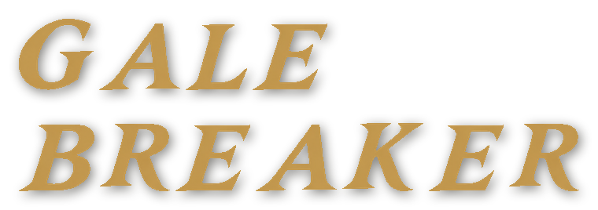

### Elemental Clash

**Luta 1x1 em 3D com alma de PlayStation 1.**
Peças rígidas low-poly, texturas pintadas à mão em 256 px e rostos que trocam de expressão, numa praia tropical onde cada menu é um lugar.

<br>


<br>

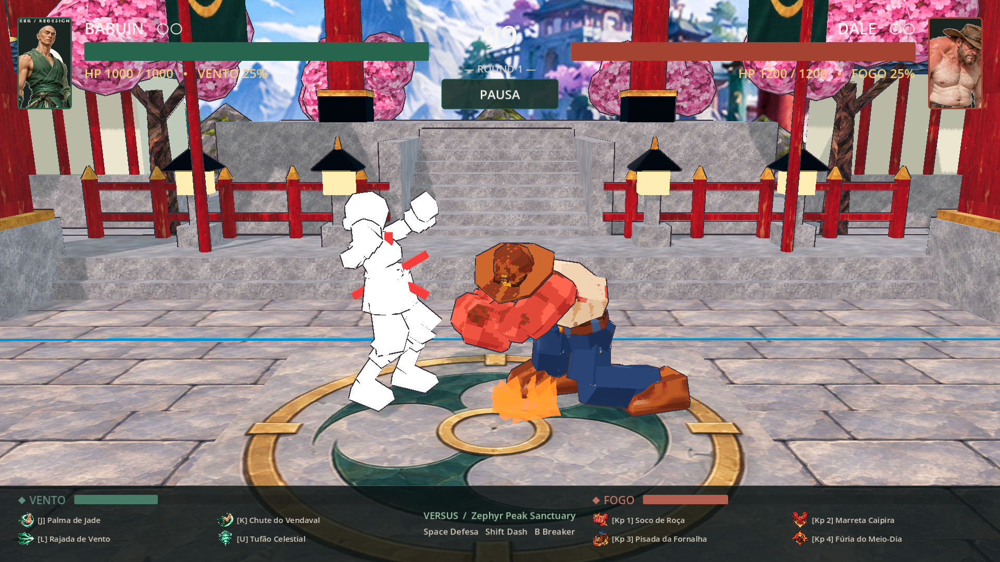

<sub><i>Dale desce a marretada no Babuin no Santuário do Pico. Captura do jogo.</i></sub>

</div>

<br>

## 🌊 O menu é a praia

Nada de telas chapadas: o jogo abre numa praia em 3D, e cada modo leva a câmera para um canto dela.

<table>
<tr>
<td width="50%" align="center">
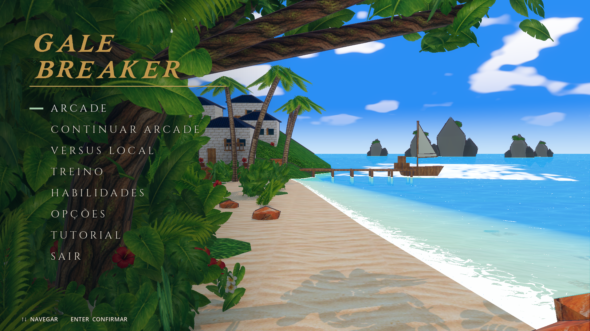<br>
<b>Menu principal</b><br>
<sub>A lista fica sobre a praia, com mar, ilhas e folhagem em volta.</sub>
</td>
<td width="50%" align="center">
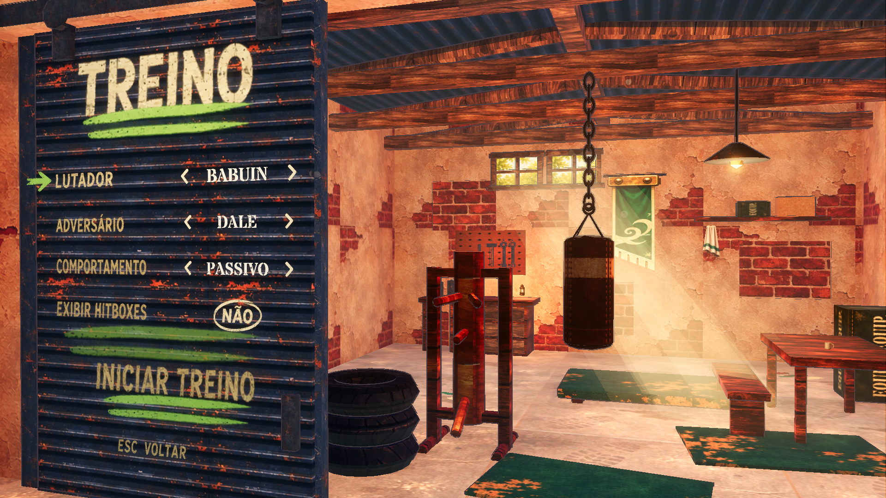<br>
<b>Treino</b><br>
<sub>A câmera gira 180° até a garagem. O menu é pintado em estêncil no portão.</sub>
</td>
</tr>
<tr>
<td width="50%" align="center">
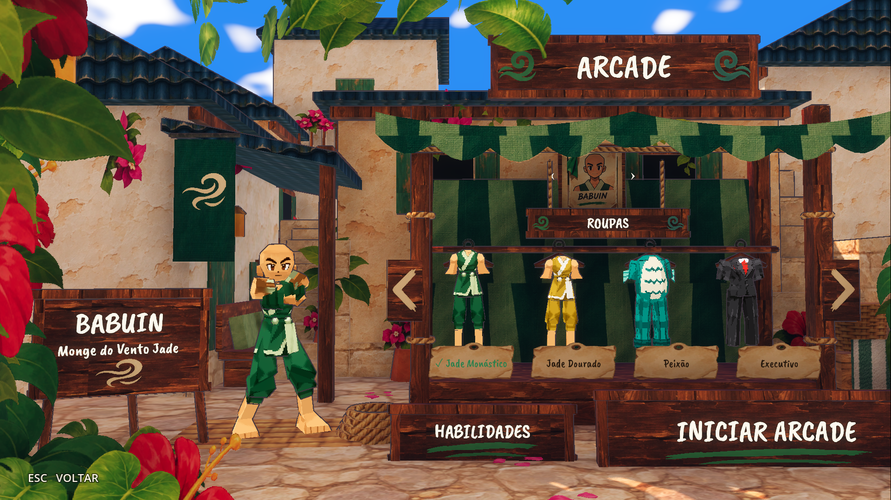<br>
<b>Arcade</b><br>
<sub>Um fade leva ao pátio da vila. As roupas ficam no cabide da barraca.</sub>
</td>
<td width="50%" align="center">
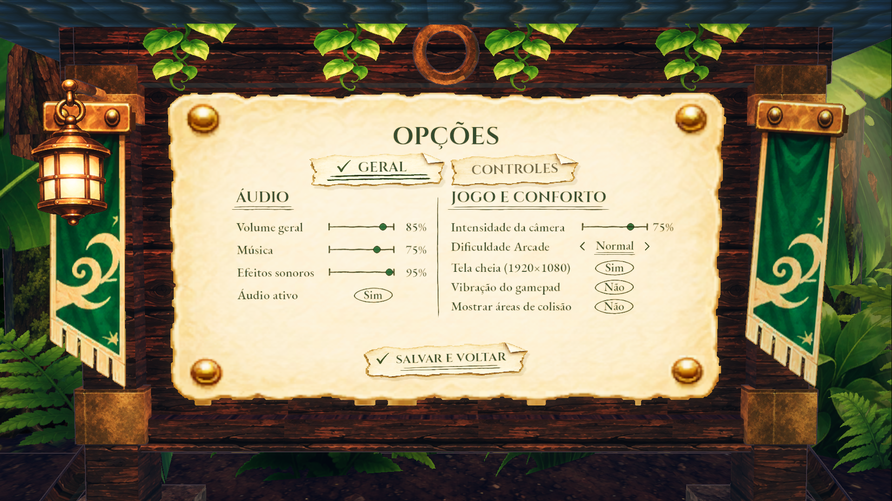<br>
<b>Opções</b><br>
<sub>A câmera entra na mata até um quadro de avisos em papel e caneta.</sub>
</td>
</tr>
</table>

<br>

## 🥋 Lutadores

<table>
<tr>
<td align="center" width="25%">
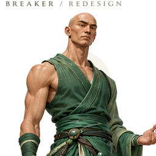<br>
<b>BABUIN</b><br>
<sub>Monge do Vento Jade</sub><br>
<code>VENTO</code>
</td>
<td align="center" width="25%">
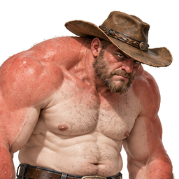<br>
<b>DALE</b><br>
<sub>Brutamontes do Sol escaldante</sub><br>
<code>FOGO</code>
</td>
<td align="center" width="25%">
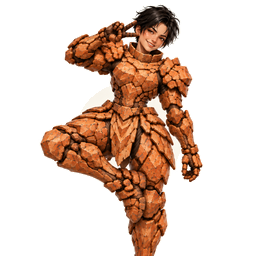<br>
<b>TOPHIA</b><br>
<sub>Cavaleira de Arenito</sub><br>
<code>TERRA</code>
</td>
<td align="center" width="25%">
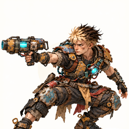<br>
<b>VOLT</b><br>
<sub>Inventor da Sucata Elétrica</sub><br>
<code>RAIO</code>
</td>
</tr>
<tr>
<td valign="top"><sub>Palmas e chutes rápidos, com a guarda de wing chun. Roupas: Jade, Jade Dourado, Peixão e Executivo.</sub></td>
<td valign="top"><sub>Grappler pesado: antebraço, lariat e marretada com os dois punhos, com o impacto segurado na tela.</sub></td>
<td valign="top"><sub>Controle de espaço com pedra e espinhos.</sub></td>
<td valign="top"><sub>Pressão constante com o canhão de sucata.</sub></td>
</tr>
</table>

> Babuin e Dale já estão no visual novo, inspirado em Mega Man Legends (1997). Tophia e Volt são os próximos.

<br>

## 🔥 Arenas

<table>
<tr>
<td width="33%" align="center"><br><b>Santuário do Pico</b></td>
<td width="33%" align="center">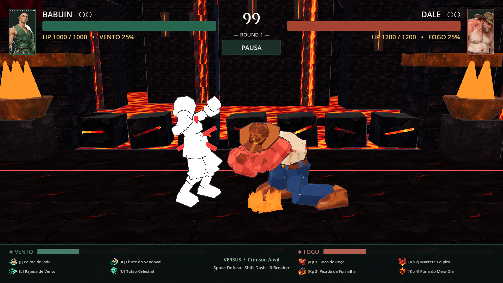<br><b>Forja Carmesim</b></td>
<td width="33%" align="center">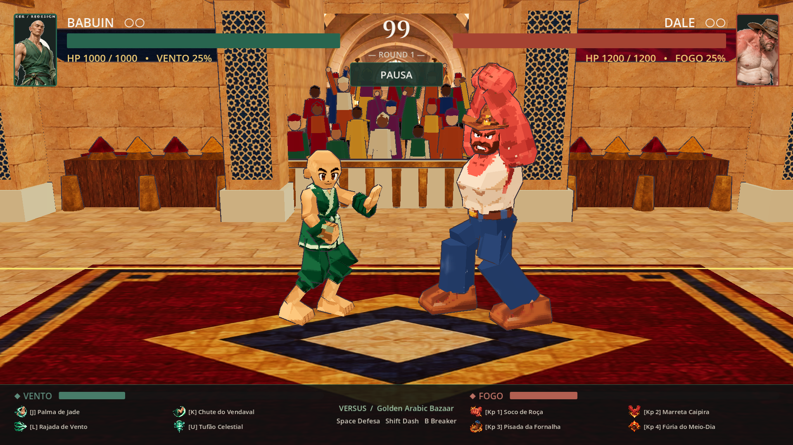<br><b>Bazar Dourado</b></td>
</tr>
</table>

Cada arena tem objetos que podem ser arremessados e quebrados, e um evento com aviso prévio: rajada, erupção ou carga em queda.

<br>

## 🎨 O estilo

| | |
|---|---|
| **Modelos** | Peças rígidas, cada uma presa a um único osso, com cerca de 750 triângulos por lutador. |
| **Texturas** | Uma página de 256×256 px com 15 cores, filtro *nearest* e sombra pintada à mão. |
| **Rostos** | Um atlas com 24 expressões, trocadas em tempo real (grito, dor, KO, piscada…). |
| **Animação** | Animação limitada: poses seguradas, sem interpolação, com antecipação curta, corte seco para o impacto e o golpe segurado no acerto. |
| **Cenário** | Céu toon, raios de luz entrando pelas janelas e sombra de folhas no pátio. |

<br>

## 🕹️ Como jogar

| Ação | Jogador 1 | Jogador 2 | Controle |
|---|---|---|---|
| Mover | `A` `D` | `←` `→` | Analógico / direcional |
| Pular · Agachar | `W` `S` | `↑` `↓` | `A` · baixo |
| Básico · Forte | `J` `K` | `Num1` `Num2` | `X` `Y` |
| Elemental · Ultimate | `L` `U` | `Num3` `Num4` | `B` `RB` |
| Defesa · Dash | `Espaço` `Shift` | `Num0` `Enter` | `LB` `R3` |
| Breaker | `B` | `Num5` | `L3` |

`Esc` pausa · o teclado pode ser remapeado nas Opções · dois controles são reconhecidos automaticamente.

<br>

## ▶️ Rodando

```bash
# Jogar: abra o executável gerado em godot/builds/
# Editar: importe godot/project.godot no Godot 4.7 e aperte F5

# Testes
./godot/tools/test.ps1 -GodotPath <caminho do Godot console exe>
```

<br>

## 📁 Estrutura

| Pasta | Conteúdo |
|---|---|
| [`godot/`](godot/) | O jogo (Godot 4.7). Detalhes em [godot/README.md](godot/README.md). |
| [`art-source/`](art-source/) | Arquivos do Blender e os scripts que geram modelos, texturas, cenários e animações. |
| [`concept-art/`](concept-art/) | Concepts, referências e prompts. |
| [`docs/gdd/`](docs/gdd/) | Game Design Document (HTML e PDF). |
| [`web/`](web/) | Protótipo web original (React + Three.js). |

<br>

<div align="center">
<sub>Feito com Godot, Blender e muita referência de PlayStation 1.</sub>
</div>
