# Estudo: como os modelos do Mega Man Legends são construídos

Objetivo: entender, peça por peça, como o Mega Man, a Roll, o Old Man e o Wily (`concept-art/referencias/*.obj`) são modelados, e tirar disso as regras para os personagens do Gale Breaker. A concept de cada personagem dá só tamanho e forma; **a construção vem destes modelos**.

Todos os números são medidos nos `.obj`, com cada modelo escalado para 1,80 m. As imagens estão em [legends-modelagem/](legends-modelagem/):
- `*_sem_textura_*`: cinza, sombreado liso;
- `*_arame_*`: o mesmo com a malha;
- `*_cabeca_*`: a cabeça de perto, com e sem textura.

## 1. Números

| Modelo | Triângulos | Peças | Cabeça (triângulos) | Simetria | Triângulos por vértice (comum / máx.) |
|---|---|---|---|---|---|
| Mega Man | 486 | 18 | 132 (cabelo 86, pele 43, olhos 3) | corpo 100%, cabeça 56% (pontas do cabelo) | 5–7 / 10 |
| Roll | 476 | 20 | 114 (com o boné) | corpo 100%, cabeça 93% | 5–7 / 14 (topo do boné) |
| Old Man | 253 | 14 | 42 | 100% | 4–7 / 10 |
| Wily | 278 | 15 | 74 | 100% | 4–7 / 12 |

- **Simetria:** todo o corpo é simétrico, com as peças em pares espelhados exatos. Só as pontas do cabelo do Mega Man fogem disso.
- **Triângulos por vértice:** quase todo vértice tem de 4 a 7 triângulos em volta. O máximo é 10 a 14, e só em um ou dois pontos de cada modelo (topo do boné, raiz do cabelo).
  - **Não existe vértice onde tudo converge.** O meu cabelo da X12 fechava 41 triângulos num ponto só, o que não acontece em nenhum deles.
- **NPCs adultos (Old Man, Wily):** têm metade dos triângulos do Mega Man. O corpo é um bloco e a cabeça é uma caixa chanfrada.

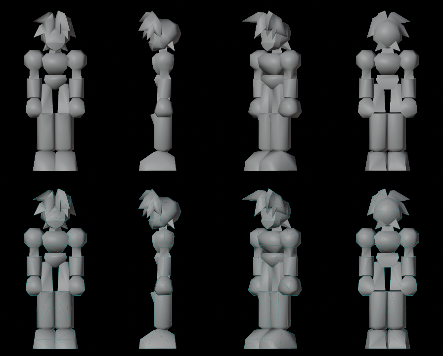
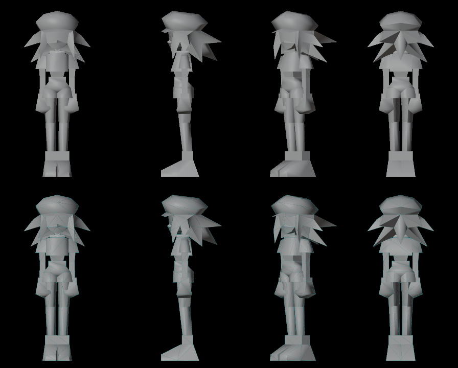
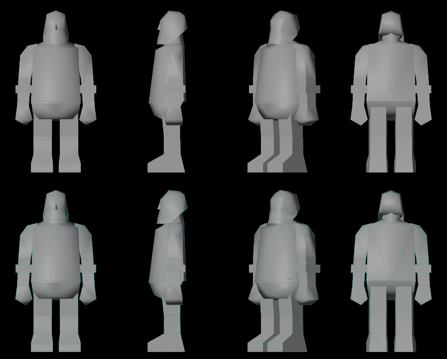

## 2. Cabeça: uma peça só, dividida pela pintura

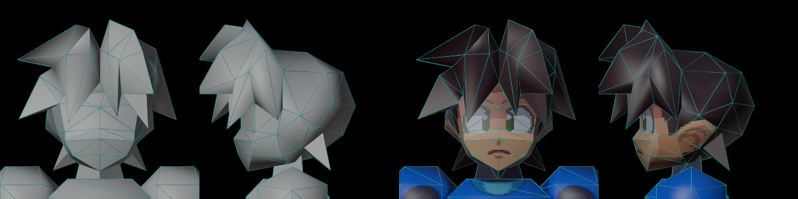
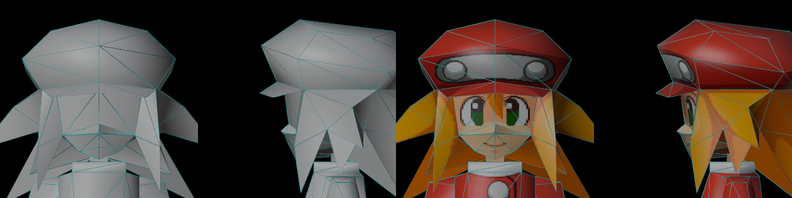
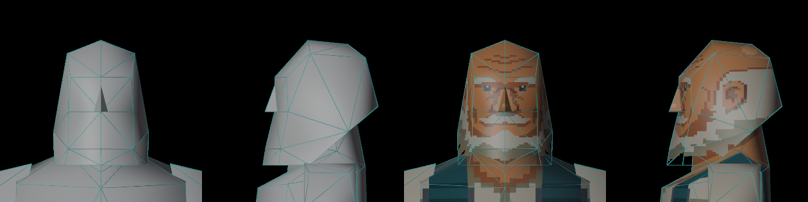
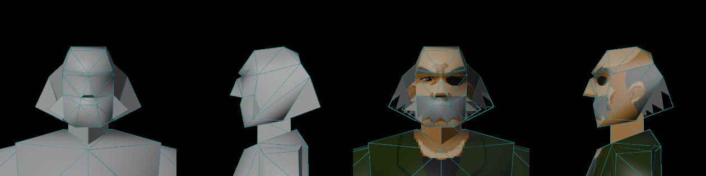

- **Cabeça e cabelo são uma única malha fechada.** A divisão entre cabelo e pele é da textura. Mesmo assim, sem textura dá para ler o que é cabelo, rosto, nariz e orelha, porque cada um tem a sua forma.
- **Cabelo do Mega Man:** lâminas triangulares grandes que **são a própria casca do crânio** atrás e em cima. Na frente, as lâminas caem sobre a testa e se apoiam no rosto. Não existe calota lisa por baixo.
- **Cabelo da Roll:** a franja e as mechas laterais são placas finas penduradas na frente e dos lados do rosto, e o boné é a parte de cima da mesma peça.
- **Old Man:** a cabeça é uma caixa chanfrada. Cabelo e barba são só pintura; a única saliência é o nariz.
- **Wily:** o cabelo lateral é feito de abas com pontas para fora, e a barba é uma placa na frente do queixo.

### Rosto

| | Mega Man (medido) |
|---|---|
| Linha do centro | 7 vértices em x = 0: topo da testa, sobrancelha, entre os olhos, base do nariz, ponta do nariz, boca, queixo |
| Faixa dos olhos | 1 a 2 faces grandes por lado (3 faces com o branco do olho no total), sem cortes dentro dos olhos |
| Nariz | a ponta avança **2,2 cm** à frente da linha dos olhos (é o ponto mais à frente do rosto) |
| Boca | **1,5 cm** atrás da ponta do nariz |
| Queixo | **4,3 cm** atrás da ponta do nariz, em V até um vértice só |
| Orelha | uma placa de 3 a 4 triângulos |
| Pele do rosto | 43 triângulos |

- **Poucos triângulos nos olhos:** a textura do olho tem de cair num plano só, sem dobra, senão distorce.
- **Perfil verdadeiro:** o nariz sai, a boca volta e o queixo volta mais. É assim que se lê um rosto de lado.

## 3. Corpo, peça por peça (Mega Man)

| Peça | Triângulos | Seção (lados por anel, de cima para baixo) | Forma |
|---|---|---|---|
| Pescoço | 6 | 3 | prisma triangular curto |
| Tronco | 28 | 4 → 2 → 2 → 4 | bloco com o peito marcado |
| Ombro + braço | 40 | 2 → 6 → 6 → 4 → 4 | **esfera de 6 lados** no ombro e um braço fino de 4 lados saindo dela |
| Antebraço | 20 | 6 → 6 | **cilindro de 6 lados**, mais grosso que o braço |
| Mão (punho) | 22 | 4 → 4 → 4 → 1 | caixa com a frente fechada em ponta |
| Quadril | 18 | 4 → 1 → 1 → 1 → 4 | bloco em V entre as pernas |
| Coxa | 14 | 3 → 2 → 4 | prisma reto e estreito |
| Canela | 30 | 8 → 2 → 6 → 1 | prisma reto, mais largo embaixo (bota) |
| Pé | 22 | 4 → 2 → 2 → 1 → 4 | bloco comprido com a ponta chanfrada |

- **O braço afina e cresce de novo:** esfera no ombro, braço fino, antebraço cilíndrico grosso, mão grande.
- **As pernas são retas,** praticamente dois retângulos de frente e de lado.
- **NPCs adultos ainda mais simples:** a canela do Old Man e do Wily é uma caixa de 4 lados com 8 a 12 triângulos.

### Juntas: as peças se sobrepõem

| Junta | Sobreposição vertical |
|---|---|
| Ombro × tronco | 24 cm (o ombro cobre a lateral do tronco) |
| Coxa × quadril | 7 cm |
| Pescoço × cabeça | 6 cm |
| Pé × canela | 6 cm |
| Mão × antebraço | 4 cm |
| Antebraço × ombro | 2 cm |
| Canela × coxa | 1 cm |
| Pescoço × tronco | 1 cm |

Peças atravessarem umas às outras nas juntas é normal e esperado. A junta não precisa ser costurada, só não pode abrir buraco quando dobra.

## 4. Por que eles parecem lisos

- O `.obj` traz uma **normal por vértice** (414 linhas `vn` no `Megaman.obj`). O sombreamento passa em degradê entre as faces, que é o Gouraud do PS1. As arestas duras só aparecem onde a normal muda de propósito.
- As peças da X12 estavam com **sombreamento chapado** (uma normal por face), e por isso cada corte aparecia.
- Não é questão de ter mais polígonos.

## 5. Referências do estilo PS1 (SuitNTie: anúncios e vídeos)

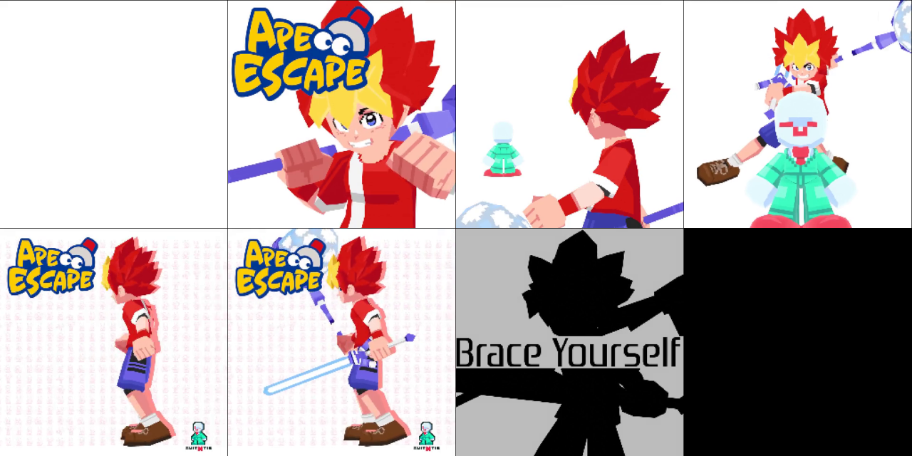
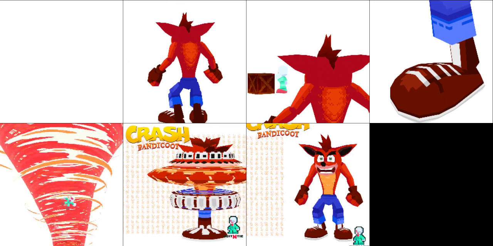
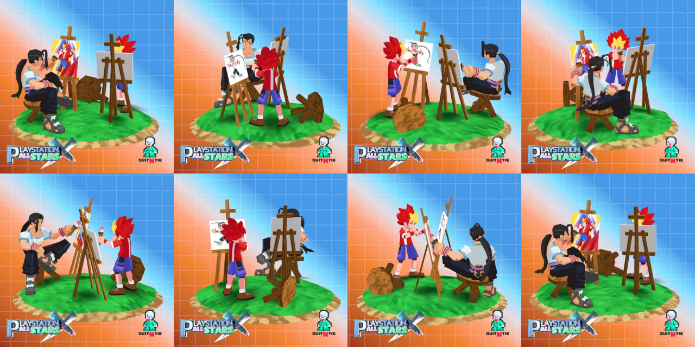

- Fei Fong, Volnutt, Spike, Crash, Goku e Vegeta seguem o mesmo padrão:
  - a forma é muito simples;
  - **punhos e pés são grandes e em blocos;**
  - os membros são prismas retos.
- **Todo detalhe é textura pixelada:** músculos, dobras de roupa, linhas do cabelo, sombra.
- **Rosto:** a frente é quase plana, com os olhos grandes pintados. O nariz é uma cunha pequena.
- **Cabelo:**
  - em pontas, o cabelo é um conjunto de lâminas grandes, como o do Spike e o do Goku;
  - quando é preso, vira uma placa, como o rabo de cavalo da Fei.

### Tifa: a referência mais próxima da X12 (lutadora adulta, de luvas)

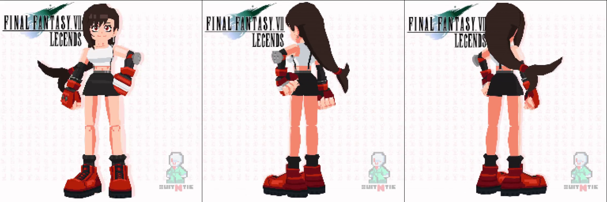
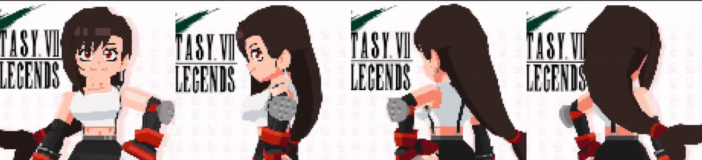

- **Proporção:** a cabeça tem ~18% da altura, como uma adulta e não como o Mega Man. As pernas são longas.
- **Pernas:** dois prismas retos e finos de 4 lados. A junta do joelho é só uma emenda reta.
- **Botas:** blocos enormes. É nelas, e nas luvas, que fica o peso visual.
- **Braços:** finos. As luvas de luta são caixas grandes com faixas, maiores que o antebraço.
- **Tronco:** blocos simples. O top, a barriga e a saia curta são prismas que abrem um pouco. Os detalhes (alças, cinto, umbigo) estão pintados.
- **Cabeça e cabelo:** uma peça só.
  - A franja é uma placa grossa sobre a testa.
  - Dos lados, duas mechas em placa emolduram o rosto.
  - O cabelo comprido de trás é uma única lâmina longa que afina até a ponta presa.
- **Rosto:** frente plana, olhos grandes pintados com contorno escuro. Nariz e boca quase só de pintura.

### Sam (Death Stranding) e cenário

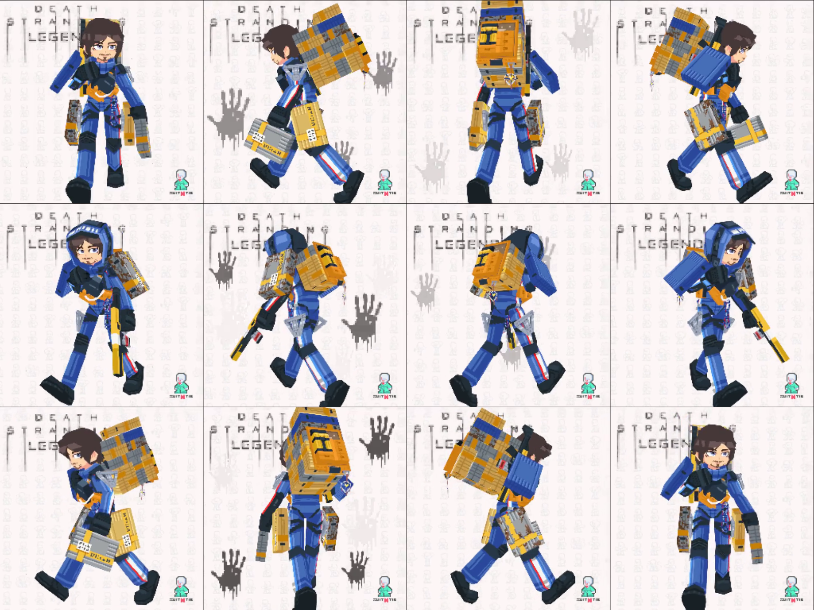
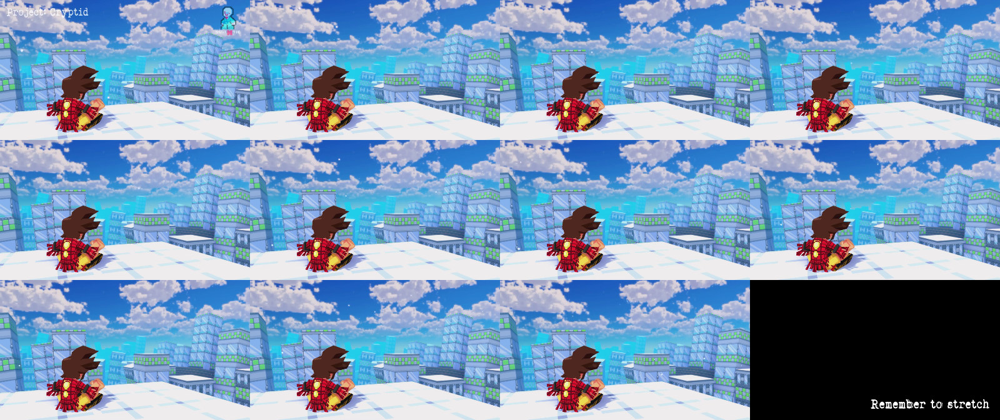

- **Sam:** mesmo um personagem cheio de equipamento continua simples.
  - Cada caixa, mochila e bota é um bloco.
  - Os membros são prismas de 4 a 6 lados.
  - Faixas, listras, alças e o capuz estão na textura.
- **Cenário:** os prédios são caixas e as janelas são textura. O céu é uma pintura.

## 6. Regras para os nossos personagens

1. **Molde primeiro.** Antes de modelar uma peça, abrir a peça equivalente do Mega Man ou da Roll (ou do Old Man e do Wily, para adultos) e contar faces e lados. A peça nova fica nessa faixa.
2. **Cada triângulo tem motivo:** silhueta, volume ou uma dobra que a textura precisa. Detalhe vai para a textura.
3. **Simetria exata:** modelar a metade esquerda, espelhar, e manter os vértices do centro em x = 0. Exceção: as pontas do cabelo.
4. **Nenhum vértice com mais de ~8 triângulos em volta.** Nada de leque fechando uma peça num ponto só.
5. **Cabeça e cabelo numa peça só.** O cabelo é a casca, e as lâminas ou placas se apoiam no rosto. Sem textura, tem de dar para ler o que é cada coisa.
6. **Rosto:**
   - linha do centro com 7 vértices;
   - faixa dos olhos com 1 a 2 faces por lado;
   - nariz saindo uns 2 cm;
   - boca recuando, queixo em V;
   - orelha em placa.
7. **Corpo:**
   - ombro esférico de 6 lados;
   - braço fino de 4 lados;
   - antebraço em cilindro de 6 lados;
   - punho em caixa grande;
   - pernas retas;
   - pés em bloco.
8. **Juntas sobrepostas, sem costura.**
9. **Sombreamento suave (normais por vértice)** e arestas duras só onde a forma pede.
10. **Antes de mostrar:**
    - medir a simetria;
    - medir o máximo de triângulos por vértice;
    - comparar o número de faces de cada peça com o molde;
    - renderizar sem textura lado a lado com o Mega Man.

## 7. Onde a X12 errou

- O cabelo era uma peça separada do rosto e fechava num leque de 41 triângulos.
- Havia peças assimétricas.
- O rosto tinha cortes dentro da faixa dos olhos, e o perfil não mostrava o nariz saindo nem a boca recuando.
- Ombros, braços e pernas copiaram o número de faces do Mega Man, mas não a forma: ombro esférico, braço que afina, perna reta.
- O sombreamento era chapado.

## 8. Para você revisar

- As regras da seção 6 estão certas? Falta alguma?
- A X12 é adulta: o corpo segue o Mega Man (herói, mais detalhado) ou fica entre ele e os NPCs adultos?
- Proporção da cabeça da X12: 25% como o Mega Man, ou ~18% como a Tifa (adulta, lutadora, o caso mais parecido com a X12)? Os NPCs adultos ficam em 21% (Old Man) e 15% (Wily).

## 9. Decisões do usuário (2026-11-07)

- As regras da seção 6 valem e foram passadas para a skill `legends-character`.
- **Todos os lutadores têm o nível de detalhe de herói** (Mega Man, Roll, Tifa), porque é jogo de luta. Os NPCs Old Man e Wily servem só para estudo.
- **A X12 é adulta e segue a Tifa:** cabeça com ~18% da altura, pernas longas, peso visual nas luvas (os punhos de pedra) e nas botas.

## 10. Texturas: como os modelos de referência são pintados

Medido nos `.png` e nas UVs dos `.obj`. As imagens mostram as UVs de cada peça desenhadas sobre a página, uma cor por peça.

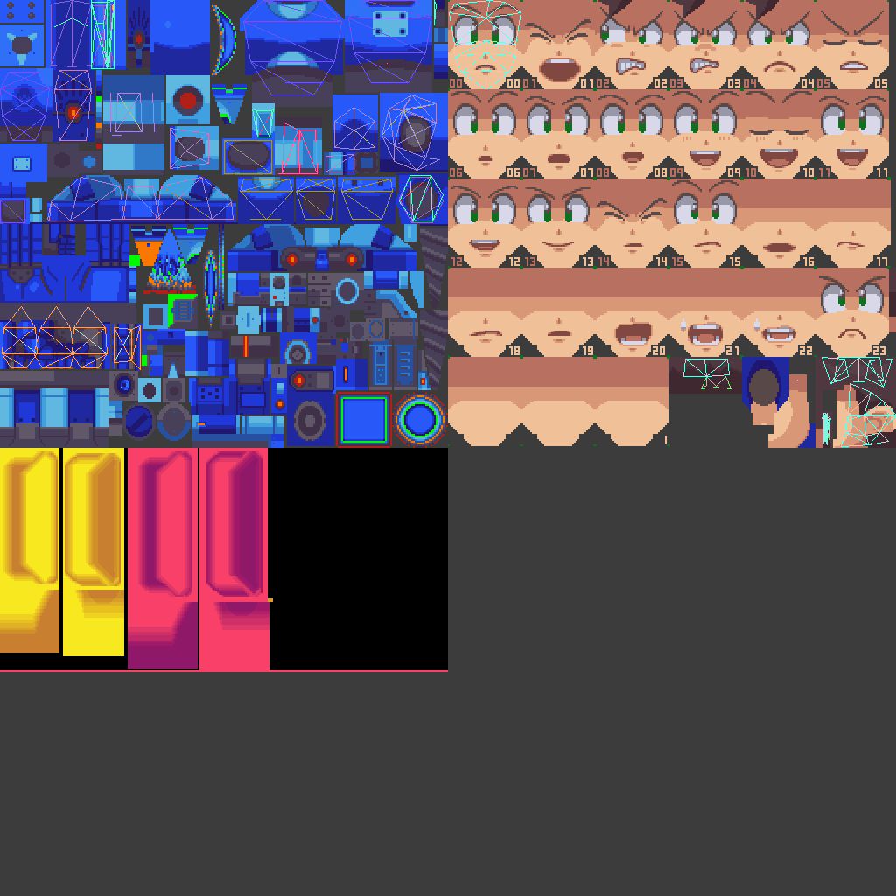
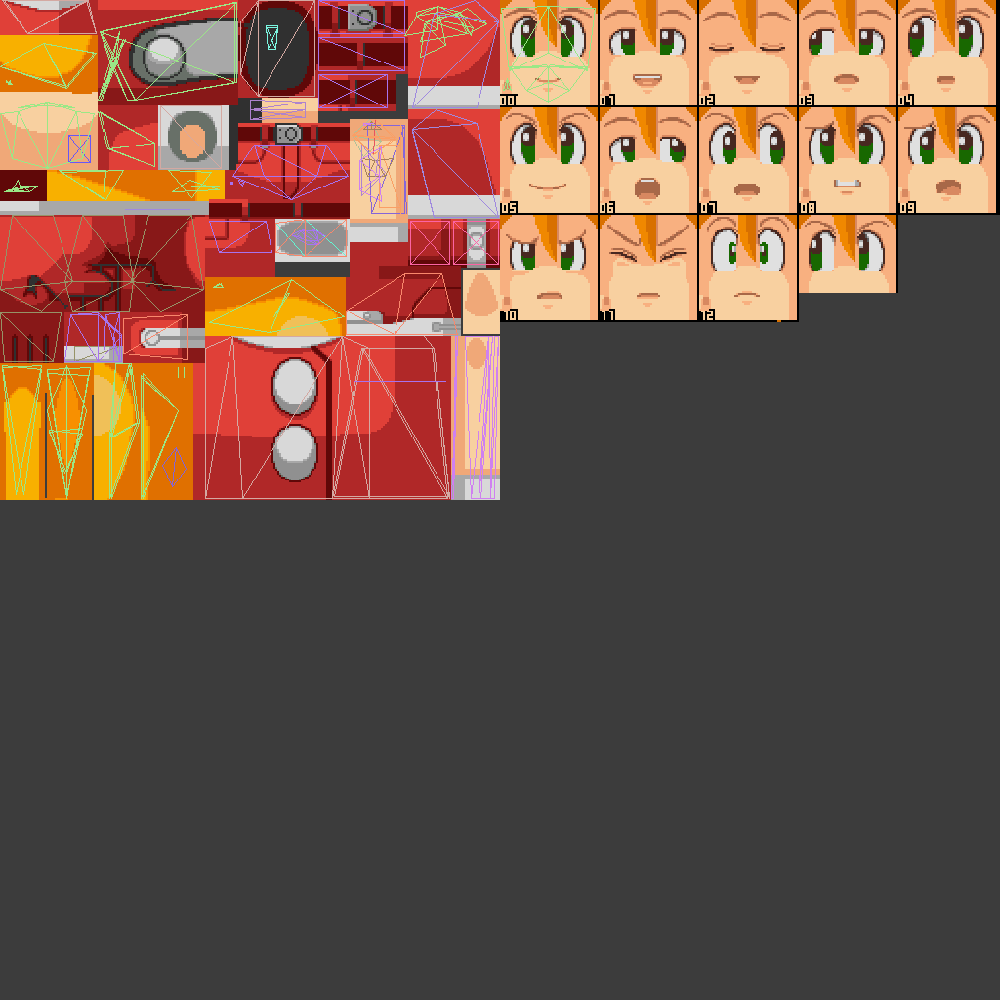
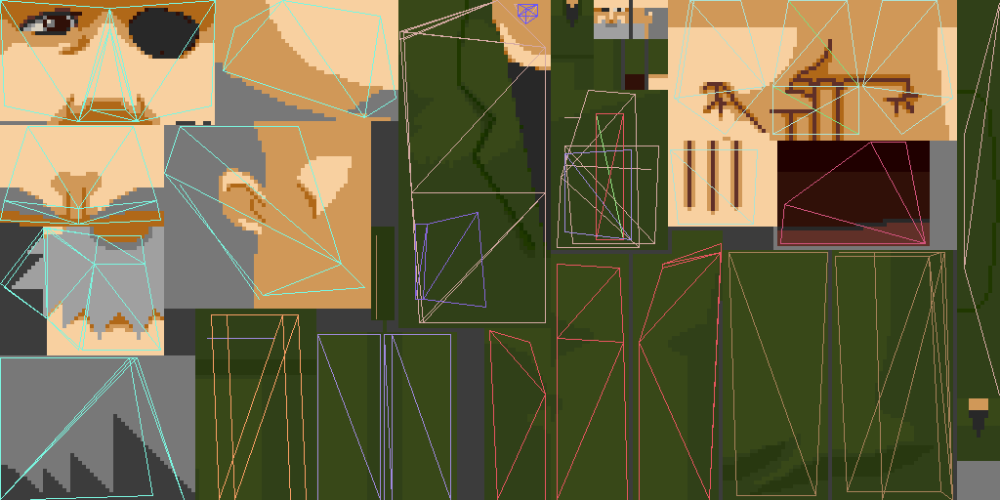

### Páginas

| | Corpo | Rosto | Cores por página |
|---|---|---|---|
| Mega Man | 1 página de 256×256 | 1 página de 256×256 com 24 expressões (6×4 quadros de ~42×50 px) | 15 + transparente |
| Roll | 1 página de 256×256 | 1 página de 256×256 com 13 expressões (~50×55 px) | 15 + transparente (12 no rosto) |
| Wily, Old Man (NPCs) | 1 página de 256×128 | rosto pintado direto na página, sem trocar expressão | 11 a 15 |

- **15 cores por página.** É a paleta de 16 cores do PS1, com uma reservada para o transparente. Cada página tem a sua própria paleta.
- **O rosto não está na página do corpo.** A frente da cabeça aponta para um quadro da página de expressões, e trocar a expressão é trocar o quadro. A franja e as sobrancelhas aparecem pintadas dentro de cada quadro (Roll).
- **A página do corpo do Mega Man também guarda as peças trocáveis** (braço buster, itens). Elas ocupam o espaço livre da mesma página.

### UV

- **O lado direito usa a mesma área da textura que o esquerdo.** No Mega Man e na Roll, braço, perna, mão e pé direitos têm as UVs idênticas às do esquerdo, porque a pintura é espelhada. Nas peças do centro (tronco), as duas metades têm UV própria. Na cabeça do Mega Man, 38 de 132 triângulos reaproveitam a metade espelhada, e na saia da Roll, 19 de 72.
  - Assim sobra página para dar mais pixels às peças importantes.
- **Densidade:** cerca de **1 a 1,5 px por cm** no corpo. O peito e as mãos da Roll chegam a 2 a 2,6 px/cm, porque a frente do personagem é o que mais aparece. As partes escondidas ficam com 0,3 a 0,6 px/cm (pescoço, parte de dentro da coxa, parte de baixo do quadril).
- **Ilhas grandes e retas:** cada peça vira uma ou poucas ilhas, geralmente um retângulo desdobrado como um cilindro aberto (membros) ou a frente e as costas lado a lado (tronco). Não há ilhas picadas em vários pedaços.

### Pintura

- **Sombra pintada em faixas duras, sem degradê:** duas ou três cores por material (claro, médio, escuro). A luz vem de cima e da frente, e o lado de baixo e as dobras ficam escuros.
- **Contorno pintado:** linhas escuras de 1 px marcam placas, dobras, botões e costuras. É a "geometria" que não existe na malha, como as placas da saia da Roll e os botões dela.
- **Detalhe só na textura:** botões, frisos, logotipos, dedos, olhos, boca.

### Regras para os nossos personagens

1. **Duas páginas de 256×256 por personagem:** corpo e rosto, cada uma com 15 cores mais o transparente. As peças trocáveis (mão aberta, por exemplo) entram no espaço livre da página do corpo.
2. **Rosto:** página de expressões com 24 quadros (6×4), a frente da cabeça apontando para o quadro.
3. **Membros esquerdo e direito com a mesma UV,** pintura espelhada. Exceção: quando a concept tem detalhe de um lado só (o "X12" da ombreira esquerda e a faixa branca de um pulso da X12), essa peça ganha ilha própria.
4. **Peças do centro com a UV inteira,** ou espelhada quando a pintura for simétrica.
5. **Densidade de 1 a 1,5 px/cm, mais na frente do tronco e nas mãos,** menos no que fica escondido.
6. **Ilhas grandes e simples:** membro desdobrado como cilindro aberto, tronco com frente e costas.
7. **Pintura em faixas duras, com 2 ou 3 tons por material e contorno escuro de 1 px.** O detalhe que não está na malha vai para a pintura.
