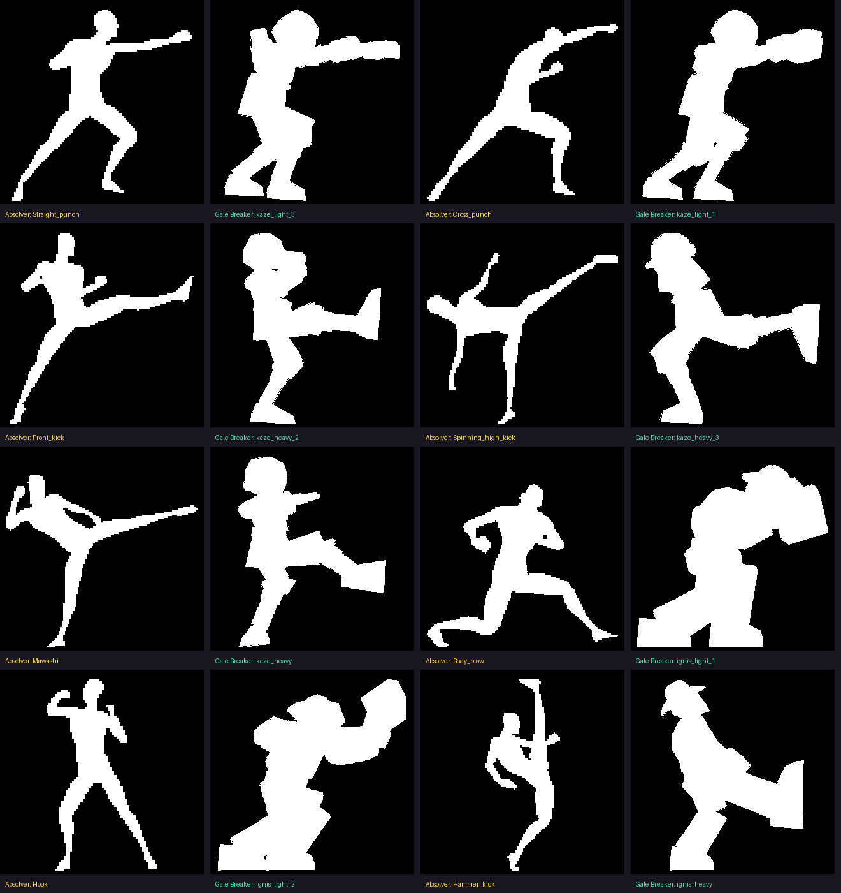
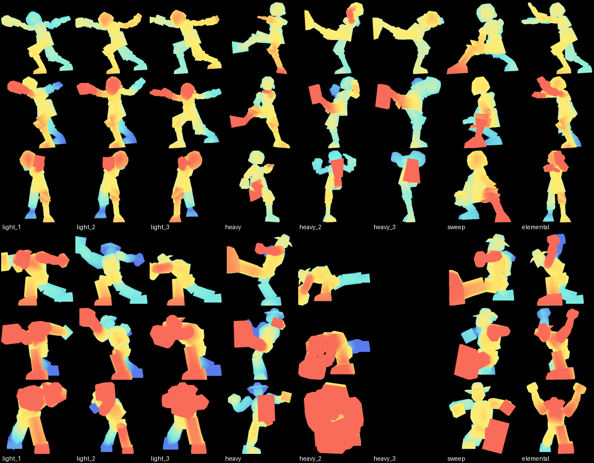

# Poses de ataque e game feel em jogos de luta

Estudo feito em novembro de 2026 a partir de Street Fighter (SF4, SFV, SF6, Third Strike), Guilty Gear (Xrd, Strive), Dragon Ball FighterZ e Absolver, com Smash (Sakurai) e Killer Instinct como referência de hitstop e leitura de golpe.

**Para que serve:** é o contexto da próxima rodada de animações (roadmap: "mais exageradas e dinâmicas, irrealistas, com anatomia humana básica") e a base de uma skill de animação. As seções 2 a 6 valem para qualquer lutador; a seção 7 traduz tudo para o pipeline do Gale Breaker.

**Confiança das informações.** Cada ponto traz a origem:
- **[fonte]**: lido numa fonte listada no fim.
- **[resumo]**: vem de um resumo gerado por IA da palestra da Arc System Works na GDC 2015. A palestra e o PDF dela não puderam ser lidos direto.
- **[geral]**: conhecimento geral de animação, não confirmado nas fontes lidas.

---

## 1. Resumo em dez linhas

1. **A pose de contato é o golpe.** O jogador lê o ataque quadro a quadro; uma pose forte vale mais que muitos quadros.
2. **Expressividade vence precisão.** A ArcSys descartou animação cheia porque "parecia 3D demais" [resumo]; a Capcom recuou de um visual realista no SFV porque "deixou o jogo bem mais difícil de jogar" [fonte].
3. **O soco sai do quadril e das pernas,** não do punho. Linhas de ação retas, torção do tronco e cabeça entrando no golpe [fonte].
4. **Silhueta fechada e com profundidade** (membros se sobrepondo, lado bem definido) ganha da silhueta "chapada" de manual [fonte].
5. **Exagero seletivo:** mãos, pés e músculos maiores, escala animada à mão, malha deformada por pose [fonte][resumo].
6. **Antecipação não se economiza:** é o que deixa o adversário reagir. Golpes pesados têm uma pausa visível e um som seco no início [fonte].
7. **Animação limitada:** cada quadro é uma pose-chave, segurada, com corte seco para a próxima [resumo][fonte].
8. **O impacto é uma pilha de camadas:** congelamento (hitstop), vibração da vítima, faísca no ponto de contato, flash, som, câmera e reação. Cada camada escala com a força do golpe [fonte].
9. **Momentos especiais têm tratamento especial:** contra-ataque com texto grande e câmera lenta, câmera dramática só nos supers [fonte].
10. **Golpes se encadeiam por poses:** a pose final de um golpe é a pose inicial do próximo [fonte].

---

## 2. O que cada jogo ensina

### Street Fighter

- **Os jogadores leem quadro a quadro.** "Players play Street Fighter not second by second, but frame by frame" (Toshiyuki Kamei, Capcom, GDC) [fonte]. Os músculos e as extremidades são exagerados "para o jogador ver as nuances" que decidem a luta [fonte].
- **Realismo atrapalhou.** O SFV começou com um visual mais realista, e isso "made it much harder to play the game" [fonte].
- **O Forte da Sakura, SF4 contra SFV** (análise de Richmond Lee) [fonte]:
  - **De onde vem a força:** no SF4 ela "gira para dentro do soco, soca com o quadril". No SFV "é como se o punho a puxasse para a frente".
  - **Pernas:** no SF4 fica claro como elas a empurram; no SFV não dá para saber qual perna está na frente.
  - **Linha de ação:** a pose do SFV tem a linha mais óbvia pela regra de manual, mas é "uma pose muito mais fraca": chapada, e não dá nem para saber para que lado ela está virada. A do SF4 é mais "dimensional", com cabeça e membros virados para dentro e a silhueta fechada, de modo que as sobreposições se leem.
  - **Cabeça:** no SF4 ela se inclina e torce para dentro do golpe, com o queixo recolhido, a ponto de nem aparecer o rosto. Isso dá impacto e é a forma correta de socar.
  - **Saca-rolha:** no SF4 o punho termina girando, como num soco de verdade. Isso dá impacto e sobe o ombro para proteger o rosto.
  - **Retas, não curvas:** "para um soco parecer forte, você precisa de poses-chave fortes com linhas de ação bem retas". Nada de transformar tudo em curva e arco, porque "this is a fight not a dance".
  - **Movimento secundário:** a faixa da cabeça no SF4 tem um arco feito à mão. No SFV é física procedural "seca".
  - **Referência:** as poses do SF4 seguiram de perto o sprite 2D da Sakura. Os SF 2D são a melhor referência.
- **Third Strike:**
  - **Volume:** é o recordista de quadros de animação em jogos de luta 2D: 23.039 no total, cerca de 700 a 1.200 por personagem, a 60 fps [fonte].
  - **O que analistas destacam:** linha de ação, squash and stretch, curvas em C e em S, smear e "lead and follow", quando uma parte lidera e o resto do corpo segue [fonte].
  - **Movimento:** Dan Root destaca que o Third Strike enfatiza o movimento muito mais que o SFV [fonte].
- **SF6:**
  - **Captura:** começa na captura de movimento, com lutadores reais (um breakdancer para o Jamie, Kenny Omega para o Alex), que os animadores depois ajustam e enfatizam [fonte].
  - **Efeitos:** toda a linguagem visual do sistema Drive saiu do Drive Impact. O Perfect Parry ganhou efeito extra para ser "mais empolgante" que um Drive Impact [fonte].
  - **Câmera lenta:** quando dois Drive Impacts colidem, a câmera lenta deixa claro quem venceu [fonte].

### Guilty Gear Xrd (2014) e Strive (2021)

Os dois são em 3D, mas renderizados para parecer anime 2D. É o caso mais próximo do nosso: 3D com cara de outra mídia.

- **Animação:**
  - **Limitada, no estilo do anime japonês.** "Cada quadro é tratado como uma pose-chave", como em stop-motion [resumo].
  - **Animação cheia foi descartada.** Ela foi testada e "deixava o visual mais 3D do que 2D" [resumo].
  - **Rig:** cerca de 500 ossos por personagem, pensado para animar quadro a quadro [resumo].
  - **Escala à mão:** a escala é animada manualmente para exagerar as ações [resumo].
  - **Malha deformada em cada pose,** de propósito, para quebrar a perfeição matemática do 3D [resumo].
  - **Transições quebradas:** romper as transições perfeitas entre quadros deixa cada pose mais expressiva [resumo].
  - **Princípio declarado:** expressividade acima de precisão [resumo].
- **Efeitos:** a maioria são partículas animadas. Os efeitos de acerto são sequências de imagens 2D trocadas a cada quadro, e a fumaça de pulo é modelada quadro a quadro [resumo].
- **Luz:** cada personagem tem a própria luz, fixa em todos os cenários, para que o desenho das sombras nunca engane o jogador [resumo]. Sombras pintadas por vértice, texturas sem filtro e sem mipmap, contorno por casca invertida [resumo]. Isso é quase idêntico ao que fazemos (página 256 em NEAREST, sombra pintada, contorno).
- **Strive:**
  - **Contra-ataque:** um letreiro enorme de "COUNTER" junto com câmera lenta. Segundo uma prévia, isso "reforça a sensação de poder" do contra-ataque [fonte]. Um patch estendeu a câmera lenta do contra-ataque a todos os golpes normais de P e K [fonte].
  - **Roman Cancel:** cancela o golpe com uma onda de choque e deixa o adversário em câmera lenta [fonte].
  - **Wall break:** quebrar a parede joga o adversário na próxima área numa cena cinemática. Os desenvolvedores ajustaram o sistema para quem quebra **comemorar**, e não se frustrar [fonte].
  - **Câmera:** movimento drástico de câmera foi "uma espécie de tabu" nos jogos anteriores, fora de alguns golpes grandes [fonte].

### Dragon Ball FighterZ

- **Chaves em degrau:** a animação usa chaves em degrau em vez de curvas suavizadas, então os personagens "saltam" de pose em pose. Isso deixa os artistas ajustarem a luz de cada quadro, o que dá o visual chapado de anime [fonte].
- **Só o que aparece:** só se animam as poses que vão para a tela, imitando sprites desenhados à mão [fonte].
- **Ritmo:** uma nota de animação diz que um personagem recente foi animado "em 8" em vez de "em 4" como o resto do elenco, ou seja, cada pose segura 8 ou 4 quadros [fonte, nota de fã].
- **Efeitos:** os efeitos dos golpes são boa parte do visual "desenhado à mão" [fonte].

### Absolver

- **Posturas:** há quatro, definidas pela orientação em relação ao inimigo. "Cada ataque começa e termina numa postura específica, então uma sequência pode girar sobre si mesma ou levar o jogador a outra postura" [fonte].
- **Consequência para a animação:** a pose final de um golpe tem que ser a pose inicial do próximo. É isso que deixa as sequências fluírem [inferência sobre a fonte].
- **Ataque perfeito:** acertar no tempo exato encadeia mais rápido e atordoa por mais tempo [fonte].
- **Fintas:** dá para cancelar o golpe durante a preparação. Isso exige uma preparação visível e legível [fonte].
- **Lemas:** "combat is a dance", "movement is your weapon", "make your move". O objetivo declarado é um jogo onde "a dinâmica do corpo e a sensação de impacto são primordiais" [fonte].

### Smash (Sakurai) e Killer Instinct: o impacto e a leitura

- **Hitstop (Sakurai, coluna na Famitsu):**
  - **Os dois congelam** "pelo mesmo tempo". Quanto mais dano, mais longo, mas sempre com um **teto** para golpes gigantes não travarem o jogo [fonte].
  - **Ajustes por golpe:** a ponta da espada do Marth tem hitstop maior que a base da lâmina. Projéteis têm menos. Golpes elétricos têm mais [fonte].
  - **Vibração:** durante o hitstop a vítima vibra, o que "simula o choque melhor do que só congelar" [fonte].
    - No chão vibra para os lados; no ar, para cima e para baixo. Na vertical, no chão, o pé atravessaria o piso.
    - A amplitude começa grande e diminui ao longo dos quadros congelados.
    - Em 3D o atacante também vibra, um pouco.
    - A caixa de dano não se mexe, então nenhum golpe passa a errar.
  - **Transição para a dor:** durante o hitstop, a vítima leva **4 quadros** para passar do primeiro quadro de impacto para a pose de dor. Trocar de uma vez fica estranho [fonte].
  - **Micro-movimento:** durante o hitstop o atacante continua se mexendo numa velocidade imperceptível, como a espada num golpe forte [fonte].
  - **2D e 3D:** o hitstop aparece mais nos jogos 2D. Em 3D, congelar no instante do dano "pode parecer ambíguo", daí a transição de 4 quadros [fonte].
- **SF2 (Critpoints):**
  - **Duração:** o hitstop congelava os dois por cerca de 10 quadros [fonte].
  - **Combo:** o cancelamento para especial entra no fim do hitstop, então o combo sai sempre igual. O hitstop é ao mesmo tempo sensação **e** janela de input [fonte].
  - **Faísca:** marca o ponto exato do contato [fonte].
  - **Sem hitstop** (Dark Souls 2), o impacto "enfraquece na percepção" [fonte].
- **Reações de dano em Smash:**
  - **Quantidade:** cada personagem tem 9 reações, em três intensidades de dano, mais as de arremesso: no mínimo 12 [fonte].
  - **Exagero:** são exageradas de propósito, para a dor ser lida [fonte].
  - **Por corpo:** não se reaproveitam entre corpos diferentes [fonte].
- **Killer Instinct:**
  - **Leitura:** os golpes pesados são reagíveis porque têm "uma leve pausa visual e um som seco" no início. Os leves quase não dão para distinguir [fonte].
  - **Silhueta e antecipação (Dan Fornace):** "a silhueta é a coisa mais importante em jogos de luta", e "os desenvolvedores costumam economizar na antecipação" [fonte].
  - **Pausas de acerto:** os momentos de quietude no acerto ou na defesa "ajudam o jogador a registrar o que aconteceu" [fonte].

---

## 3. O que faz uma pose de ataque ser *diferenciada*

São doze princípios, em ordem de importância. Cada um diz o que fazer e o erro comum a evitar.

1. **A pose de contato é o produto.** Desenhe-a primeiro, como uma ilustração que funcione parada, e só depois a preparação e a recuperação. *Erro:* começar pela trajetória e deixar o contato "onde cair".
2. **Linha de ação reta, do pé de trás ao ponto de impacto.** O calcanhar de trás, o quadril, o ombro e o punho (ou a bota) ficam quase numa reta. As curvas em C ficam para a antecipação e a recuperação. *Erro:* tudo em arco, que parece dança.
3. **A força vem do chão.** As pernas empurram de forma legível, o quadril gira antes do ombro e o ombro antes do punho (lead and follow). No contato o tronco está torcido para dentro do golpe. *Erro:* o braço estica e o corpo fica parado.
4. **Cabeça e queixo para dentro.** A cabeça acompanha o golpe e cai atrás do ombro, e o rosto pode até sumir. A expressão aparece na antecipação e na recuperação. *Erro:* a cabeça reta, olhando a câmera.
5. **Silhueta fechada, com sobreposição e lado claro.** Testada **na câmera do jogo** (lateral), não na vista de modelagem. Precisa dar para ler qual é a perna da frente e para que lado o lutador olha. *Erro:* pose "aberta de manual", chapada, com tudo esticado no mesmo plano.
6. **Exagero anatômico seletivo.**
   - Aumentar o membro que bate (mão ou pé de 1,2× a 1,4×) e esticar o antebraço ou a canela no quadro do golpe.
   - Inchar o ombro ou o peito na pancada.
   - Deformar o que for preciso para a pose ler.
   - Anatomia básica é o limite: as juntas dobram para o lado certo e o peso cai sobre a base.
   
   *Erro:* exagerar tudo igual, porque aí nada se destaca.
7. **Antecipação contrária e proporcional.** Antes de ir para a frente, o corpo vai para trás e para cima ou para baixo; antes de girar para um lado, gira para o outro. Golpes leves: uma pose. Pesados e especiais: preparação longa e legível, com pausa e som. *Erro:* cortar a antecipação para o golpe "ficar rápido", o que tira a leitura e o peso.
8. **Animação limitada.** Poucas poses fortes, seguradas, com **corte seco** entre elas e sem interpolação mole. Velocidade vem do salto entre poses, não de quadros intermediários. Um quadro de "esticada" (smear) logo antes do contato vende a velocidade [geral]. *Erro:* curvas suaves ligando poses, que é o visual "3D de motor de jogo".
9. **Segurar o impacto, depois o follow-through.** A pose de contato fica parada durante o hitstop. Em seguida o corpo continua um pouco além (overshoot, peso indo para a frente) e assenta. Golpe pesado = recuperação visivelmente cara. *Erro:* voltar à guarda logo depois do contato.
10. **Movimento secundário à mão.** Tecido, cabelo, chapéu, faixa: arcos chaveados que atrasam e passam do ponto. *Erro:* física procedural "seca" ou nenhum secundário.
11. **Encadeamento por poses.** O fim do J1 é o começo do J2, e uma postura leva a outra. A sequência inteira tem que ler como uma frase coreografada. *Erro:* cada golpe volta à guarda, e o combo vira três golpes soltos.
12. **Assinatura do personagem.** Cada lutador tem um ritmo e um formato de silhueta reconhecíveis:
    - o Babuin chicoteia: rápido, linhas longas, tecido atrasando;
    - o Dale esmaga: preparação curta, corpo inteiro, pose larga e baixa segurada.
    
    *Erro:* todos com a mesma curva de tempo e o mesmo exagero.

---

## 4. Juice: as camadas de um acerto, quadro a quadro

A ordem abaixo é de um acerto pesado a 60 fps. Os números são **ponto de partida** para calibrar, não regra das fontes, exceto onde indicado.

| Momento | Atacante | Vítima | Tela / som |
|---|---|---|---|
| Preparação | Pose de antecipação segurada; nos pesados, uma pausa visível | — | Som seco de "carregar" no começo dos pesados [fonte KI] |
| Quadro do golpe | Quadro de smear (membro esticado), corte seco para o contato | — | — |
| **Contato (quadro 0)** | Pose de contato; mão ou pé aumentado | Primeiro quadro de impacto | Faísca no **ponto exato** do contato [fonte]; som do golpe; flash curto |
| Hitstop (de 6 a 18 quadros, cresce com o dano, com teto) | Parado, ou com micro-movimento imperceptível [fonte] | **Vibra** (no chão para os lados, no ar para cima e para baixo), amplitude caindo; transição de 4 quadros para a pose de dor [fonte] | Tremida de câmera só nos pesados, curta e decrescente |
| Fim do hitstop | Follow-through (overshoot) | Reação de dor com recuo; o nível depende da força | Janela de cancelamento (o combo entra aqui) [fonte] |
| Recuperação | Assenta na guarda; nos pesados, recuperação cara e visível | Volta, cai ou é lançada | — |

**Escalas de impacto.** Todas as camadas sobem juntas: leve → médio → pesado → especial → ultimate.

- **Hitstop:** maior.
- **Vibração:** maior.
- **Faísca:** maior.
- **Tremida:** só a partir do pesado.
- **Reação:** pula para o nível de cima.

O golpe "forte" que não tem nenhuma camada a mais que o leve não parece forte.

**Momentos especiais:**
- **Contra-ataque** (acertar o adversário durante a preparação dele): letreiro grande, hitstop extra e um instante de câmera lenta [fonte GGST].
- **Golpe final, quebra de parede ou finalização:** câmera lenta, câmera dramática e celebração [fonte GGST]. A câmera dramática fica **reservada** a esses momentos e aos supers, nunca nos golpes comuns, porque o jogador precisa julgar a distância [fonte GGST].
- **Colisão de dois golpes iguais:** câmera lenta para mostrar quem venceu [fonte SF6].

**Reações de dano em níveis:**
- **Leve:** só a cabeça e o tronco tombam.
- **Médio:** o corpo dobra e recua um passo.
- **Pesado:** dobra inteiro e perde a base.
- **Knockdown, lançamento e esmagamento.**

Também por direção: alto ou baixo, frente ou trás. As reações são exageradas e se leem de longe [fonte].

**Luz e cor:** a luz de cada personagem é fixa em todos os cenários, para a sombra nunca mentir sobre a forma [resumo]. O flash de acerto deve ser curto. Um flash branco longo apaga a pose da vítima justamente no quadro em que ela deveria ler melhor [geral; observado nas nossas capturas].

---

## 5. Anatomia de um golpe

### Soco forte (pesado), em poses

1. **Guarda:** a base do personagem.
2. **Antecipação:** o tronco gira para trás, o punho recua para perto do rosto ou do quadril e o peso vai para o pé de trás. O joelho da frente fica pronto para empurrar. Pose segurada.
3. **Smear** (opcional, 1 quadro): o antebraço esticado, o tronco a meio giro.
4. **Contato:**
   - o pé de trás empurra e o calcanhar sobe;
   - o quadril e depois o ombro giram para dentro, e o punho fecha em saca-rolha;
   - a cabeça e o queixo entram atrás do ombro;
   - a mão aumenta de 1,2× a 1,35×;
   - o pé, o quadril, o ombro e o punho ficam em linha reta;
   - a pose fica segurada pelo hitstop.
5. **Follow-through:** o corpo passa um pouco do ponto e o peso cai no pé da frente.
6. **Recuperação:** o corpo volta à guarda em uma ou duas poses.

### Chute

É a mesma lógica:

- **Antecipação:** o joelho recolhe alto, a perna de apoio gira o pé (pivot) e os braços equilibram, com o braço do lado do chute descendo.
- **Contato:** o pé ou a canela vem primeiro, com o pé aumentado, o tronco inclinado para trás e a linha reta da cabeça à bota.

---

## 6. Checklist para revisar uma animação de ataque

Este checklist é a base da futura skill. Responda olhando **na câmera do jogo**, com a pose parada.

- [ ] A pose de contato funciona como ilustração parada? Dá para saber o golpe sem ver o movimento?
- [ ] Há linha de ação reta do pé de trás ao ponto de impacto?
- [ ] As pernas e o quadril mostram de onde vem a força? O tronco está torcido para dentro?
- [ ] A cabeça entra no golpe, com o queixo recolhido?
- [ ] A silhueta é fechada, com sobreposições legíveis? Dá para ver qual perna está na frente e para onde o lutador olha?
- [ ] O membro que bate está exagerado (escala ou esticada) e o resto não?
- [ ] As juntas dobram para o lado certo? O peso está sobre a base (anatomia básica)?
- [ ] A antecipação vai na direção contrária e tem duração proporcional? O pesado tem pausa e som?
- [ ] As poses são seguradas, com corte seco, sem interpolação mole?
- [ ] O contato fica parado durante o hitstop? Existe follow-through depois?
- [ ] Tecido, chapéu e faixas atrasam e passam do ponto?
- [ ] A pose final encaixa no próximo golpe da sequência?
- [ ] O golpe tem a assinatura do personagem (ritmo, formato)?
- [ ] O juice está no nível certo: hitstop, vibração, faísca, tremida e reação proporcionais à força?
- [ ] O corpo inteiro foi para o golpe? A base mudou (avanço, apoio, salto) e o quadril se deslocou tanto quanto o membro?
- [ ] Há contrapeso (tronco para longe do chute, braço de trás recuando)?
- [ ] O membro que bate está totalmente esticado e alinhado com o tronco?
- [ ] De perfil, o membro que bate está fora do contorno do tronco? A silhueta difere da dos outros golpes do lutador?

---

## 7. Aplicação no Gale Breaker

### 7.1 Onde cada princípio mora no nosso pipeline

As poses são escritas em `art-source/tools/legends_<id>_anim.py` e resolvidas por `legends_anim.place()` com IK. Os tempos ficam em `anim_timing.py`, nos marcadores `wind`, `contact`, `hold`, `follow`, `recover` e `end`. O Godot mapeia startup para [0, contact], ativo para [contact, follow] e recuperação para [follow, end], e o hitstop fica em `combat.gd` (`LIGHT_FEEL`, `HEAVY_CHAIN`, `hitstopFrames`).

| Princípio | Chave ou lugar no pipeline |
|---|---|
| Linha de ação, força do chão | `feet` (pé de trás atrás, calcanhar com `up`), `hips` (avanço e afundo), `turn.hips` antes de `turn.chest` |
| Torção e saca-rolha | `turn.hips/spine/chest` em sentidos encadeados; `aim` do punho girado no contato |
| Cabeça para dentro | `turn.head` compensando o tronco e apontando para o alvo; `shrug` do ombro do golpe para a frente |
| Exagero seletivo | `scale` em `hand_*`/`foot_*` (de 1,2× a 1,4×), `forearm_*`/`shin_*` esticados, `chest`/`upper_arm_*` inchados na pancada |
| Smear | um quadro antes do contato com `scale` do antebraço em `(1, 1.35, 1)` (o Babuin já faz isso) |
| Antecipação | a chave `wind`; os leves com uma chave, os especiais com várias (a Pisada da Fornalha tem 4) |
| Animação limitada | chaves em degrau (`AUTHORED_STEPPED` no `fighter_view.gd`), poses seguradas entre chaves |
| Segura o impacto | `contact` e `hold` com a mesma pose (a segunda levemente assentada), coberta pelo hitstop |
| Follow-through | `follow` passando um pouco do ponto, `recover` assentando |
| Encadeamento | `'from': ('light_1', 17)`: o J2 começa na pose do J1 |
| Pé de apoio girando | `pivot`, `foot_turn`, `sole` |
| Expressão | `set_face`: SHOUT ou EFFORT no golpe, HURT na reação |

### 7.2 O que o jogo já tem e o que falta

Levantamento feito no código em 2026-11-05.

**Já existe:**
- hitstop por golpe e por passo de sequência (`LIGHT_FEEL`, `HEAVY_CHAIN`), com os dois lutadores congelados;
- flash na vítima (`flash` de 8 quadros);
- camada de squash e stretch e inclinação na preparação e no golpe (`fighter_view.gd`);
- tremida de câmera nos eventos pesados (`arena.gd`);
- letreiro "COUNTER HIT!";
- chaves em degrau e poses seguradas.

**Atualização de 2026-11-06:** os itens 1 a 3 abaixo foram feitos, e o KO também ganhou câmera lenta. Continuam pendentes os itens 4 a 7.

**Falta, em ordem de ganho:**
1. **A vítima não vibra durante o hitstop.** A vibração atual só roda quando o tempo de apresentação anda (`fx_shake` fica congelado com delta zero), ou seja, *depois* do congelamento. Pelo Sakurai, é justamente durante o hitstop que ela vende o choque. Falta vibração horizontal no chão e vertical no ar, decrescente, só visual, com a caixa de dano parada.
2. **O contra-ataque não tem camada extra.** Hoje ele dá 20% de dano e 5 quadros de atordoamento a mais e mostra o texto, mas não tem hitstop maior nem câmera lenta. Vale somar hitstop extra, um instante de câmera lenta e o letreiro maior, como no Strive.
3. **O flash branco cobre a vítima inteira por 8 quadros** e apaga a pose de dor no quadro em que ela mais deveria ler (visto nas capturas da luta, com o Babuin todo branco). Melhor um flash de 2 a 3 quadros, ou só nas bordas e no contorno.
4. **A transição de impacto para dor:** entrar na reação com uma ou duas poses intermediárias durante o hitstop, em vez de pular direto.
5. **Reações em níveis:** hoje há um `hit` por lutador. Faltam reações leve, média e pesada, e alta e baixa.
6. **Câmera lenta e câmera dramática** só no golpe final do round, nas finalizações e nos ultimates (o roadmap já pede "vitórias com cutscene").
7. **A faísca no ponto de contato** deve sair do soquete do membro que bateu (já existem soquetes por golpe no `fighter_view.gd`) e crescer com a força.

### 7.3 Primeiros números para calibrar

A tabela é uma proposta a partir dos valores atuais do Dale e do Babuin, para testar no jogo; não é regra das fontes.

| Tipo | Antecipação | Hitstop | Vibração da vítima | Tremida | Reação |
|---|---|---|---|---|---|
| Leve (J1, J2) | 1 pose | 4 a 10 quadros | pequena | não | leve |
| Fim de sequência (J3) | 1 ou 2 poses | 7 a 18 | média | leve | média |
| Pesado (K) | 1 ou 2 poses, com pausa | 9 a 16 | média | leve | pesada |
| Especial (elemental) | 3 ou 4 poses | 12 a 18 | grande | média | pesada ou lançamento |
| Ultimate | cena com câmera | 18 a 24, com teto | grande | forte | knockdown, câmera lenta no fim |
| Contra-ataque | — | +4 a +6 sobre o normal | +1 nível | +1 nível | +1 nível, letreiro e câmera lenta curta |

O Dale fica no alto de cada faixa e o Babuin embaixo: o Dale esmaga, o Babuin chicoteia.

---

## 8. Comparação: Absolver e Gale Breaker

As silhuetas de golpes do Absolver ([wiki](https://absolver.wiki.fextralife.com/Bare-hands_Attacks)) foram comparadas com as nossas no quadro de contato. As nossas foram renderizadas de perfil, na câmera do jogo, por `godot/tests/capture_silhouettes.gd`, e todas foram ajustadas para a mesma altura.

**O que a comparação mostra:** no Absolver, **o corpo inteiro se desloca para o golpe**. Nos nossos golpes, o corpo fica parado numa base média e só o braço ou a perna sai. As diferenças por tipo:

| | Absolver | Gale Breaker hoje |
|---|---|---|
| **Base** | Muda a cada golpe: avanço longo e baixo no soco, apoio alto e esticado no chute, salto no joelho | Quase a mesma em todos os golpes: joelhos meio dobrados, pés perto da guarda (os pés andam no máximo cerca de 0,2 m) |
| **Soco** | Avanço longo. A perna de trás fica **reta** e continua na linha do tronco inclinado até o punho: uma diagonal só, do calcanhar ao punho | Tronco na vertical sobre as duas pernas dobradas. A linha quebra no quadril |
| **Braço de trás** | Puxado para trás, junto ao peito ou ao quadril (oposição) | Também vai para a frente ou fica na guarda. Os dois braços apontam para o mesmo lado |
| **Ombros** | Giram: o ombro que bate vai para a frente e o corpo fica de lado | O peito fica quase de frente para a câmera em todo golpe |
| **Chute** | Na altura do peito ou da cabeça, perna esticada. O tronco **inclina para longe** como contrapeso, a perna de apoio fica reta e os braços abrem | Na altura do quadril. O tronco fica de pé, o joelho de apoio dobrado e os braços na guarda |
| **Giratório e de cima** | O corpo vira um T (tronco quase deitado) ou a perna sobe até a vertical | De pé, com o chute frontal à meia altura |
| **Espaço vazio** | Braços e pernas separados do tronco, e o golpe se lê pelos vazios | No Dale, os braços se sobrepõem ao tronco de perfil e a silhueta vira um bloco. O J1, o J3, o soco agachado e o soco no ar do Dale têm quase a mesma forma |

**Regras novas, somadas aos princípios da seção 3:**

13. **O corpo inteiro vai para o golpe.** No contato a base muda:
    - no soco forte, o pé da frente avança e o de trás fica reto atrás;
    - no chute, o pé de apoio gira e o quadril passa por cima;
    - no golpe de cima, o corpo sobe ou cai.
    
    O quadril se desloca tanto quanto o membro que bate.
14. **Contrapeso.** Tudo que vai para um lado tem algo indo para o outro:
    - no chute, o tronco inclina para trás e para longe do pé;
    - no soco, o braço de trás recua quando o da frente sai;
    - no giro, os braços abrem para o lado contrário.
15. **Extensão total no contato.** O membro que bate fica **esticado até o fim** e alinhado com o tronco. O chute alto sai na altura do peito ou da cabeça.
16. **Espaço vazio na câmera do jogo.** No contato, o braço ou a perna que bate fica **fora** do contorno do tronco, de perfil. Dois golpes do mesmo lutador não podem ter a mesma silhueta.

O Gale Breaker não é realista como o Absolver: o Babuin e o Dale são blocos estilo PS1, com cabeça, mãos e pés grandes. As regras valem mesmo assim, e o tamanho das peças pede ainda mais exagero na base e na extensão para a forma se ler.

**Como fica no nosso pipeline (`legends_anim`):**

| Regra | O que mudar nas chaves |
|---|---|
| Base que se desloca | `feet`: o pé da frente avança de 0,4 a 0,7 m no soco forte e no avanço. `hips`: avanço de 0,25 a 0,45 e afundo maior nos avanços longos |
| Perna de trás reta | O tornozelo de trás bem atrás, a uma distância do quadril próxima do comprimento da perna (a IK estica sozinha). O calcanhar sobe com `up` |
| Tronco na linha do golpe | `turn.spine` e `turn.chest` inclinados de 20° a 40° na direção do golpe nos socos, e para trás nos chutes |
| Ombros de lado | `turn.hips` e `turn.chest` em z de 35° a 60° no contato, com o ombro que bate à frente. `shrug` desse lado para a frente |
| Oposição | A mão de trás recua até o peito ou o quadril (`hands` com y positivo) quando a outra sai |
| Chute alto | Pé na altura de 1,3 a 1,7 m (Babuin), apoio reto, `pivot` do pé de apoio de 60° a 90°, tronco de -20° a -45° (para trás), braços abertos |
| Espaço vazio no Dale | Cotovelos para fora e para longe do tronco (`elbow`), mãos fora do contorno do peito no perfil |

### 8.1 Primeira aplicação (2026-11-06)

Os golpes do Dale e do Babuin foram refeitos com essas regras:
- **Dale:** J1, J2, J3, K1, K2, soco agachado, soco no ar e elemental.
- **Babuin:** J1, J2, J3, K2 e K3. O K1 dele ficou como estava, porque foi editado à mão no Blender.

A conferência usa o mapa de calor de profundidade em três vistas (perfil, 3/4, frente), gerado por `godot/tests/capture_silhouettes.gd`. Nele, o vermelho e o amarelo estão perto da câmera e o azul está longe.

**Lições:**
- **Silhueta engana com o lado.** De perfil, um golpe do braço esquerdo e outro do direito na mesma posição dão a mesma forma (o J1 e o J2 do Dale). O mapa de calor separa os dois pela cor.
- **O jogo é 3D e os lutadores giram:** o golpe tem que ler em 3/4 e de frente também. De frente, o punho ou o pé que bate vem para a câmera, e a perna de trás esticada fica atrás.
- **Uma trilha NLA com tamanho diferente do clipe** exporta o golpe cortado ou parado. O K2 do Dale estava congelado no jogo desde que foi criado. Agora `legends_anim.sync_strips(rig)` alinha as trilhas antes de exportar.

---

## 9. Diagnóstico da X12 (2026-11-07) e regras novas

O usuário achou as primeiras animações da X12 fracas, com pouco dinamismo. A comparação com dois guias (Kevuru Games e Artemisia College, nas Fontes) e com esta skill aponta as causas:

| Problema na X12 | O que pedem os guias e a skill |
|---|---|
| Antecipação de 2 quadros e 3 cm (tempo antigo, contato no quadro 6) | Movimento contrário visível, curto para não parecer atraso de comando ("held too long can register as input lag") |
| Quadril avança 14 cm no jab; o Babuin avança de 30 a 42 cm | Poses além do natural: "subtlety disappears at full combat speed" |
| Quase sem deformação | Comprimir e esticar vende a força: "Without deformation, hits feel weightless", desde que confira a deformação com a hitbox |
| Sem quadro entre antecipação e contato | Quadro de borrão (antebraço esticado) antes do contato, como no Guilty Gear Xrd: sem interpolação, cada quadro é uma pose |
| Braço volta logo depois do contato | Passar do ponto; as partes pesadas assentam por último |
| Saia, cabelo e cabeça parados | Movimento secundário (pano, cabelo) atrasando e passando do ponto |
| Mãos em linha reta (o gancho lê como soco reto) | Arcos de movimento |

Regras que entram na skill `attack-poses`:
1. **Teste de 3 quadros:** "If the pose isn't clear at three frames, it won't be clear at thirty." O contato tem que ler como silhueta preta.
2. **Antecipação de 4 a 6 quadros nos socos leves,** visível, mas sem segurar a ponto de parecer atraso. Nos pesados é mais longa.
3. **Quadro de borrão antes do contato,** com o membro esticado 1,3 a 1,4×.
4. **Quadro passando do ponto depois do contato** (overshoot), antes de recolher.
5. **Secundário em todo golpe:** saia ou manto, cabeça e cabelo atrasam e passam do ponto.
6. **O hitstop e os efeitos caem no quadro exato do contato,** alinhados com a hitbox.
7. **Amplitude mínima:** quadril e passo de 30 a 40 cm nos socos, giro de tronco de 40° a 60°.

## 10. Socos de boxe: o que as referências corrigiram (2026-11-07)

A segunda versão do jab e do direto da X12 ainda ficou fraca. As referências mostraram o motivo: o tronco ficava ereto e a cabeça erguida e virada para o oponente.

- **Jab sem preparação.** "This punch should strike quick without any wind up that can easily be telegraphed" (SLYNYRD, Pixelblog 53). A pose-chave já aparece no primeiro quadro, o de borrão. O acerto fica um pouco mais longo, o braço avança mais um pouco no follow-through e no fim vem um estalo, um pouco além da guarda para trás.
- **Direto com preparação curta.** Ele "carrega" (os dois punhos sobem e os cotovelos abrem, "like chicken wings") e "puxa" o antebraço. No borrão, o quadril gira o corpo inteiro para o perfil: o joelho de trás vai para frente e para baixo, o calcanhar de trás sobe uns 67°, a cabeça cai e o cotovelo livre sai para trás do tronco.
- **Força vem do quadril, com a cabeça baixa.** No SF4 o soco da Sakura "goes all the way from the hips", e ela se inclina tanto que "you can barely see her head". No SF5 a cabeça fica parada olhando para frente e o soco parece estático (análise de Richmond Lee, resumida no 80.lv).
- **O pé de trás fica atrás.** A linha reta vai do calcanhar de trás até o punho. Avançar o pé de trás embola as pernas no perfil.
- **Na X12:** jab com acerto no quadro 3, direto com acerto no 8. Tronco inclinado de 26° a 30° para frente e cabeça baixa (inclinação positiva), sem contra-girar para olhar o oponente.

## Fontes

**Street Fighter**
- [What's In A Punch? Sakura's Fierce Punch in SF4 vs SF5 (Art Eater)](https://art-eater.com/articles/what-s-in-a-punch-a-comparative-analysis-of-sakura-s-fierce-punch-from-street-fighter-4-vs-street-fighter-v)
- [Overexaggerated features, silhouettes: Capcom explains their creative choices (EventHubs)](https://www.eventhubs.com/news/2017/jun/10/overexaggerated-features-silhouettes-capcom-explains-their-creative-choices-art-street-fighter)
- [How to animate a fighting game: breaking a limb (EventHubs, sobre o vídeo de Dan Root)](https://eventhubs.com/news/2018/may/26/how-animate-fighting-game-video-demonstrates-how-tricks-breaking-limb-can-really-sell-viewer-special-moves-impact)
- [Third Strike: most frames of animation (Guinness)](https://www.guinnessworldrecords.com/world-records/98823-most-frames-of-animation-in-a-2d-fighter-videogame)
- [Street Fighter III (Wikipedia)](https://ipfs.ssi.eecc.de/ipns/en.wikipedia-on-ipfs.org/wiki/Street_Fighter_III)
- [Third Strike animation breakdowns (Gumroad)](https://gameanimation.gumroad.com/l/SF3)
- [Smear frame](https://wiki.riteme.site/wiki/Smear_frames)
- [SF6 beta: Drive Impact (Infil)](https://words.infil.net/w03-sf6beta-p2.html)
- [Drive Impacts hitting simultaneously (EventHubs)](https://eventhubs.com/news/2022/sep/18/drive-impacts-hit-simultaneously-sf6)
- [Capcom on early Drive Parry design (EventHubs)](https://eventhubs.com/news/2023/jul/18/capcom-early-sf6-drive-parry)
- [Jamie's motion capture with a breakdancer (EventHubs)](https://www.eventhubs.com/news/2022/sep/17/jamie-motion-capture-sf6-breakdancer)
- [Kenny Omega motion capture for Alex (Dashfight)](https://dashfight.com/news/capcom-shows-how-kenny-omega-brought-alex-to-life-in-street-fighter-6-8474)

**Guilty Gear e Dragon Ball FighterZ**
- [GuiltyGearXrd's Art Style: The X Factor Between 2D and 3D (GDC Vault)](https://gdcvault.com/play/1022031/GuiltyGearXrd-s-Art-Style-The)
- [Resumo da palestra por IA (videohighlight)](https://videohighlight.com/v/yhGjCzxJV3E)
- [Junya C. Motomura: Behind the Scenes of Guilty Gear Xrd (BlenderNation)](https://www.blendernation.com/2015/07/26/junya-c-motomura-behind-the-scenes-of-guilty-gear-xrd/)
- [Breaking down the animation of Guilty Gear and Dragon Ball FighterZ (Kotaku)](https://kotaku.com/breaking-down-the-animation-of-guilty-gear-and-dragonba-1836849279)
- [Guilty Gear Strive: battle systems](https://www.guiltygear.com/ggst/en/battle/systems/)
- [Guilty Gear Strive closed beta impressions (TopTier)](https://toptier.gg/guilty-gear-strive-closed-beta-first-impressions-and-analysis)
- [Guilty Gear Strive 1.18 patch notes (Ginx)](https://www.ginx.tv/en/guilty-gear-strive-1-18-patch-notes)
- [The Insight: Deep Inside Guilty Gear Strive (NYGC)](https://nygamecritics.com/2021/07/21/the-insight-deep-inside-guilty-gear-strive-the-wonder-and-the-frustration/)
- [Dragon Ball FighterZ discussion: stepped animation (Kanzenshuu)](https://www.kanzenshuu.com/forum/viewtopic.php?p=1327792)

**Absolver**
- [Bare-hands Attacks, silhuetas de cada golpe (Absolver Wiki)](https://absolver.wiki.fextralife.com/Bare-hands_Attacks)
- [Choreograph Your Own Battles in Absolver (PlayStation Blog)](https://blog.playstation.com/2017/05/10/choreograph-your-own-battles-in-absolver-out-august-29/)
- [Deck-building mechanics meet brawler in Absolver (Game Developer)](https://www.gamedeveloper.com/design/deck-building-mechanics-meet-brawler-in-i-absolver-i-)

**Hitstop e leitura de golpe**
- [Thoughts on Hitstop: Sakurai's Famitsu column (Source Gaming)](https://sourcegaming.info/2015/11/11/thoughts-on-hitstop-sakurais-famitsu-column-vol-490-1/)
- [Hitstop/Hitfreeze/Hitlag/Hitpause (Critpoints)](https://critpoints.net/2017/05/17/hitstophitfreezehitlaghitpausehitshit/)
- [Sakurai on Smash Ultimate hit animations (Gameranx)](https://gameranx.com/updates/id/474375/article/masahiro-sakurai-reveals-insane-details-put-into-hit-animations-for-smash-bros/)
- [Sakurai's 8 hit stop techniques (GoNintendo)](https://www.gonintendo.com/contents/13581-sakurai-s-latest-game-dev-video-features-8-hit-stop-techniques)
- [Why fighting game devs need to think about silhouettes (Game Developer)](https://gamedeveloper.com/design/why-one-developer-says-fighting-game-devs-need-to-think-about-silhouettes)
- [On Reaction Times (Killer Instinct, Infil)](https://ki.infil.net/reaction.html)
- [Combat Animation for Games (MoCap Online)](https://mocaponline.com/blogs/mocap-news/combat-animation-games-guide)

**Não lidas**
- O PDF da palestra da ArcSys (`ggxrd.com/Motomura_Junya_GuiltyGearXrd.pdf`) recusou a conexão.
- A transcrição do vídeo de Daniel Floyd sobre GG e DBFZ (Amara) e a entrevista da Unreal sobre o Strive devolveram 403.
- O vídeo do Sakurai com as 8 técnicas de hitstop está no YouTube, e só a notícia sobre ele foi lida.

Os detalhes de escala, ritmo e frame a frame dessas fontes podem ser conferidos quando o texto for colado aqui.
- Kevuru Games, "How to Animate a Fighting Game?": https://kevurugames.com/blog/how-to-animate-a-fighting-game/
- Artemisia College, "Fighting Game Animation": https://www.artemisiacollege.com/feeds/blog/fighting-game-animation
- Raymond Schlitter (SLYNYRD), "Pixelblog 53 - Punches and Kicks": https://www.slynyrd.com/blog/2024/11/25/pixelblog-53-punches-and-kicks
- 80.lv, "Street Fighter: Making Fight Moves That Feel Right": https://80.lv/articles/street-fighter-making-fight-moves-that-feel-right
